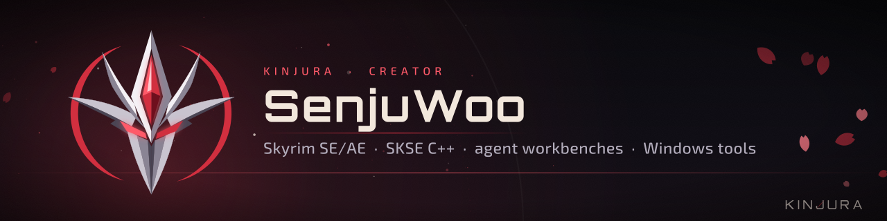
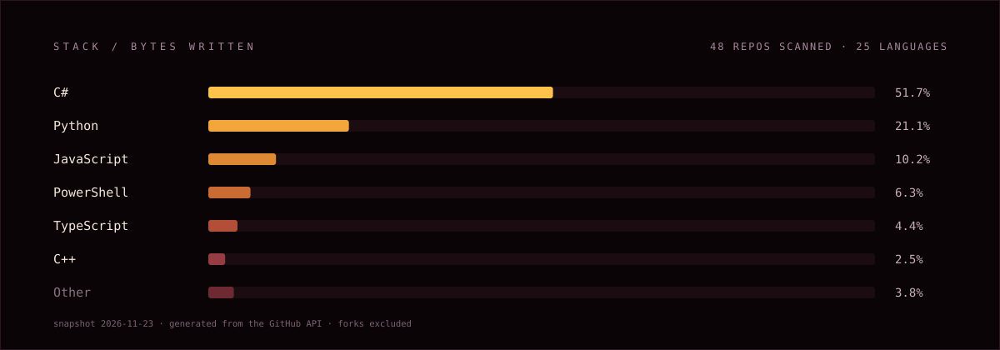

  

### Skyrim at the bottom, an agent at the top, and the tooling in between.

I build the layer that is missing between a game engine and an AI that is supposed to work on it: typed tools instead of prose, inspection instead of guessing, receipts instead of vibes. A synthetic mind is only as good as what you let it perceive.

| Lane | What lives there |
| :-- | :-- |
| **Forge workbenches** | CLI and MCP workbenches that let an agent inspect, plan, build and verify mods for one engine at a time: Skyrim, Fallout 4, Cyberpunk 2077, GTA V, Marvel Rivals, RimWorld, Roblox, Minecraft, Risk of Rain 2, Saints Row, ReSkate. |
| **Native plugins** | The SKSE / C++ work where a Papyrus script is not the answer: load caches, navmesh failsafes, enemy nerve, cosave speed. |
| **Nexus riders** | Self-contained Windows apps and installers that ship on Nexus Mods: Black Desert, Warframe, DLSS 5, a whole PC toolkit. |
| **Asset and AI tooling** | Image, 3D, audio and avatar pipelines, an agent skill bundle, local-first creative tools. |

## Selected work

| Repository | What it does | Built in |
| :-- | :-- | :-- |
| **[Ultimate-AI-Starter-Bundle](https://github.com/SenjuWoo/Ultimate-AI-Starter-Bundle)** | Skills, MCP servers and plugins for Claude, Codex, Grok, Kimi, Hermes and Antigravity, plus an optional Skyrim modding stack. | JavaScript |
| **[SkyrimForge](https://github.com/SenjuWoo/SkyrimForge)** | Safety-first typed automation workbench and MCP server for Skyrim SE/AE mod development. | Python |
| **[Gta-Forge](https://github.com/SenjuWoo/Gta-Forge)** | Make, check and ship GTA V mods against the game you actually have installed, with a GTA VI day-one kit. | Python |
| **[NextGen-Disk-Cache](https://github.com/SenjuWoo/NextGen-Disk-Cache)** | SKSE plugin that learns what the game reads at load, then prefetches exactly that into RAM on the next launch. | C++ |
| **[FollowerForge](https://github.com/SenjuWoo/FollowerForge)** | Custom Skyrim followers without the Creation Kit. | C# |
| **[FaceForge](https://github.com/SenjuWoo/FaceForge)** | Photo to RaceMenu preset: local MediaPipe, measured CharGen baselines, High Poly Head aware. | TypeScript |
| **[dlss5-aio](https://github.com/SenjuWoo/dlss5-aio)** | DLSS 5 DLLs, neural runtime and a swapper that puts them on any game. | Python |

## Everything else

<b>Forge workbenches</b>: one engine per forge

- **[Cyberpunk-Forge](https://github.com/SenjuWoo/Cyberpunk-Forge)**: redscript, CET, TweakXL, ArchiveXL, REDmod, checked against your own install.
- **[Fallout4-Forge](https://github.com/SenjuWoo/Fallout4-Forge)**: plugins, Papyrus, F4SE, BA2, FOMOD and Nexus pages.
- **[MarvelRivals-Forge](https://github.com/SenjuWoo/MarvelRivals-Forge)**: skin mods, textures, materials, meshes, physics and sound.
- **[RimWorldForge](https://github.com/SenjuWoo/RimWorldForge)**: Def indexing and mod building for RimWorld.
- **[RobloxForge](https://github.com/SenjuWoo/RobloxForge)**: current official docs, vertical-slice scaffolds and checks for Roblox games.
- **[Minecraft-Forge](https://github.com/SenjuWoo/Minecraft-Forge)** and **[Risk-Of-Rain-2-Forge](https://github.com/SenjuWoo/Risk-Of-Rain-2-Forge)**: NeoForge, Fabric and Forge mods; RoR2 plugins.
- **[SaintsRowForge](https://github.com/SenjuWoo/SaintsRowForge)** and **[ReSkate-Forge](https://github.com/SenjuWoo/ReSkate-Forge)**: Saints Row VPP/XTBL tooling; skate. plugin scaffolding.
- **[reverse-this](https://github.com/SenjuWoo/reverse-this)**: one-click reverse-engineering modkit with stable tool paths.
- **[OBS-Forge](https://github.com/SenjuWoo/OBS-Forge)**: ready-made OBS Studio setups for streaming and recording.

<b>Asset, avatar and AI tools</b>

- **[AssetForge](https://github.com/SenjuWoo/AssetForge)**: 2D/3D assets, sprites, PBR textures and sound effects with validation.
- **[comfy-forge](https://github.com/SenjuWoo/comfy-forge)**: Anima/SwarmUI images, music, 3D and datasets from the command line.
- **[illusion-forge](https://github.com/SenjuWoo/illusion-forge)**: edit Koikatsu and Honey Select 2 character cards from a prompt.
- **[AvatarForge](https://github.com/SenjuWoo/AvatarForge)**: Blender, XPS, MMD, VRM and Source models to VRChat avatars.
- **[pbp-studio](https://github.com/SenjuWoo/pbp-studio)**: local AI character maker for Castle Crashers.
- **[Woo-Force-Next](https://github.com/SenjuWoo/Woo-Force-Next)**: AI brain for Ikemen GO fighters.
- **[monstrum-codex-infinite](https://github.com/SenjuWoo/monstrum-codex-infinite)**, **[ImmersiveWorlds](https://github.com/SenjuWoo/ImmersiveWorlds)**, **[SillyTavern-LocalSearch](https://github.com/SenjuWoo/SillyTavern-LocalSearch)**, **[ai-prompt-library](https://github.com/SenjuWoo/ai-prompt-library)**: local-first creative tools and prompt suites.

<b>Skyrim plugins and mods</b>

- **[Modern-NPC-Pathing](https://github.com/SenjuWoo/Modern-NPC-Pathing)**: runtime navmesh failsafe.
- **[NemesisCombatAI](https://github.com/SenjuWoo/NemesisCombatAI)**: enemy nerve, morale and tactics.
- **[SOS-Hostile-Safeguard](https://github.com/SenjuWoo/SOS-Hostile-Safeguard)**: temporary friendly foes for Simple Offence Suppression.
- **[Faster-Loadin-n-Savin](https://github.com/SenjuWoo/Faster-Loadin-n-Savin)**: crash-safe cosave accelerator.

<b>Windows apps, installers and companions</b>

- **[windows-pc-toolkit](https://github.com/SenjuWoo/windows-pc-toolkit)**: gaming, debloat, cleanup, privacy and repair dashboard.
- **[Cephalon-Cuda](https://github.com/SenjuWoo/Cephalon-Cuda)** (Warframe) and **[Cuda-Spirit](https://github.com/SenjuWoo/Cuda-Spirit)** (Black Desert): decision cockpits for returning players.
- **[BDO-AIO](https://github.com/SenjuWoo/BDO-AIO)**, **[BDO-TEX-AIO](https://github.com/SenjuWoo/BDO-TEX-AIO)**, **[FaceForge-BDO](https://github.com/SenjuWoo/FaceForge-BDO)**, **[bdo-wardrobe](https://github.com/SenjuWoo/bdo-wardrobe)**: the Black Desert set.
- **[LosslessScaling-DLSS5-Preset](https://github.com/SenjuWoo/LosslessScaling-DLSS5-Preset)**, **[bonsai2-lmstudio-fix](https://github.com/SenjuWoo/bonsai2-lmstudio-fix)**, **[rtxhdr-guard](https://github.com/SenjuWoo/rtxhdr-guard)**, **[RAGE-Emblem-Codec](https://github.com/SenjuWoo/RAGE-Emblem-Codec)**.
- **[Opera-GX-Extensions](https://github.com/SenjuWoo/Opera-GX-Extensions)**: Nexus research tools and Opera GX companions.
- **[MSN2-CommunityPatch](https://github.com/SenjuWoo/MSN2-CommunityPatch)**, **[gta5-enhanced-woo-pack](https://github.com/SenjuWoo/gta5-enhanced-woo-pack)**, **[naruto-storm4-modpack](https://github.com/SenjuWoo/naruto-storm4-modpack)**: game patches and packs.

## The stack

## How the work gets done

- **A tool that cannot prove it did the thing is a suggestion.** Every workbench writes a receipt: what it read, what it wrote, what it verified.
- **Read the record, the offset, the log.** Not the wiki page, not the marketing copy, not last year's forum post.
- **Ship the recovery path with the change.** Preview before apply, backup before overwrite, log before silence.

## Elsewhere

- **Nexus Mods**: released mods as [GennyWoo](https://www.nexusmods.com/skyrimspecialedition/users/37128950), including [NextGen Disk Cache](https://www.nexusmods.com/skyrimspecialedition/mods/185563)
- **Releases**: prebuilt installers and archives live on each repository's Releases page

Windows box. Mostly at night. Usually because a game did something stupid.
