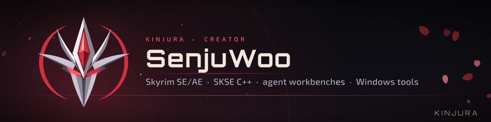
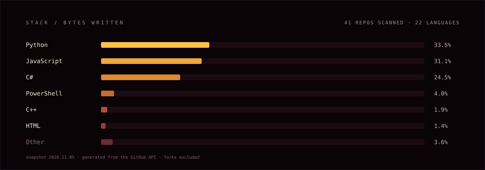

  

### Skyrim at the bottom, an agent at the top, and the tooling in between.

I build the layer that is missing between a game engine and an AI that is supposed to work on it: typed tools instead of prose, inspection instead of guessing, receipts instead of vibes.

| Lane | What lives there |
| :-- | :-- |
| **Forge workbenches** | CLI + MCP workbenches that let an agent inspect, plan, build and verify mods for one engine at a time — Skyrim, RimWorld, Roblox, Minecraft, Saints Row, Risk of Rain 2. |
| **Native plugins** | The SKSE / C++ work where a Papyrus script is not the answer: load caches, navmesh failsafes, enemy nerve, decompression, cell-offset tables. |
| **Nexus riders** | Self-contained Windows apps that ship on Nexus Mods — Black Desert, Warframe, DLSS 5, a whole PC toolkit. |

## Selected work

| Repository | What it does | Built in |
| :-- | :-- | :-- |
| **[Ultimate-AI-Starter-Bundle](https://github.com/SenjuWoo/Ultimate-AI-Starter-Bundle)** | Skills, MCP servers and plugins for Claude, Codex, Grok, Kimi, Hermes and Antigravity — plus an optional Skyrim modding stack. | JavaScript |
| **[SkyrimForge](https://github.com/SenjuWoo/SkyrimForge)** | Safety-first typed automation workbench and MCP server for Skyrim SE/AE mod development. | Python |
| **[NextGen-Disk-Cache](https://github.com/SenjuWoo/NextGen-Disk-Cache)** | SKSE plugin that learns what the game reads at load, then prefetches exactly that into RAM on the next launch. | C++ |
| **[FollowerForge](https://github.com/SenjuWoo/FollowerForge)** | Custom Skyrim followers without the Creation Kit. Seven-step wizard, 3000+ spawn spots, ESPFE output. | C# |
| **[FaceForge](https://github.com/SenjuWoo/FaceForge)** | Photo to RaceMenu preset: local MediaPipe, measured CharGen baselines, High Poly Head aware. | TypeScript |
| **[dlss5-aio](https://github.com/SenjuWoo/dlss5-aio)** | DLSS 5 DLLs, neural runtime and a swapper that puts them on any game — 64/32-bit, D3D9, Vulkan. | Python |

## The stack

## How the work gets done

- **A tool that cannot prove it did the thing is a suggestion.** Every workbench writes a receipt: what it read, what it wrote, what it verified.
- **Read the record, the offset, the log.** Not the wiki page, not the marketing copy, not last year's forum post.
- **Ship the recovery path with the change.** Preview before apply, backup before overwrite, log before silence.

## Elsewhere

- **Nexus Mods** — the released mods, including [NextGen-Disk-Cache](https://www.nexusmods.com/skyrimspecialedition/mods/185563)
- **Releases** — prebuilt installers and archives live on each repository's Releases page
- **In progress** — Risk of Rain 2 Forge, RobloxForge, riggle, Minecraft-Forge

Windows box. Mostly at night. Usually because a game did something stupid.
