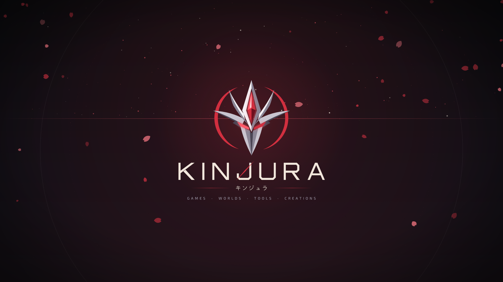
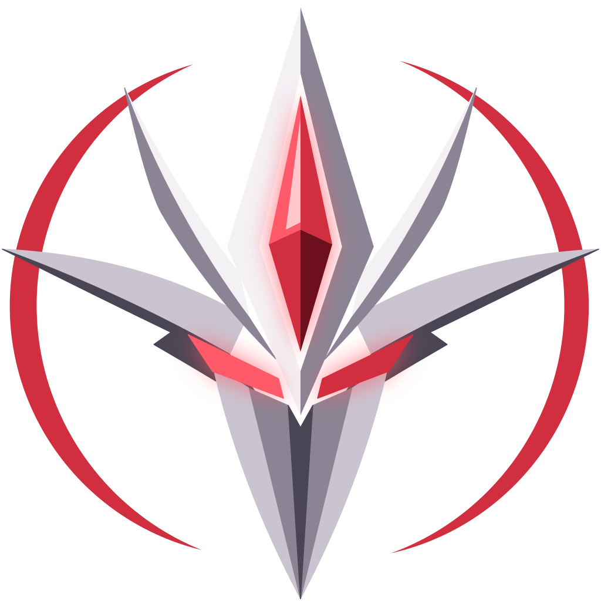
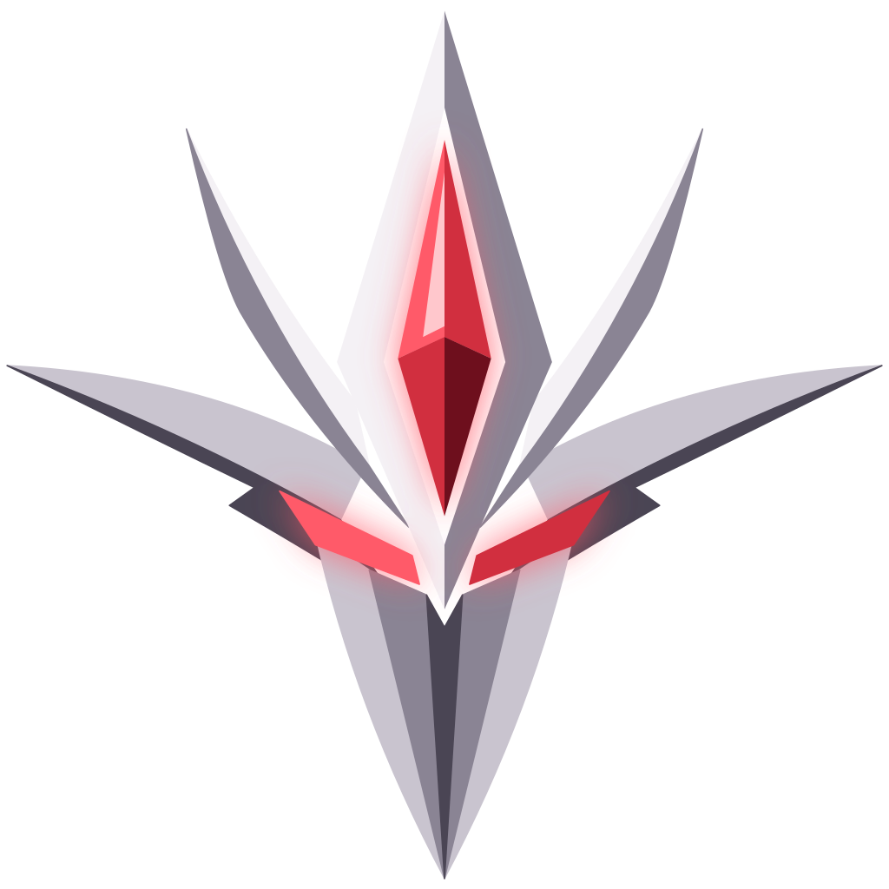
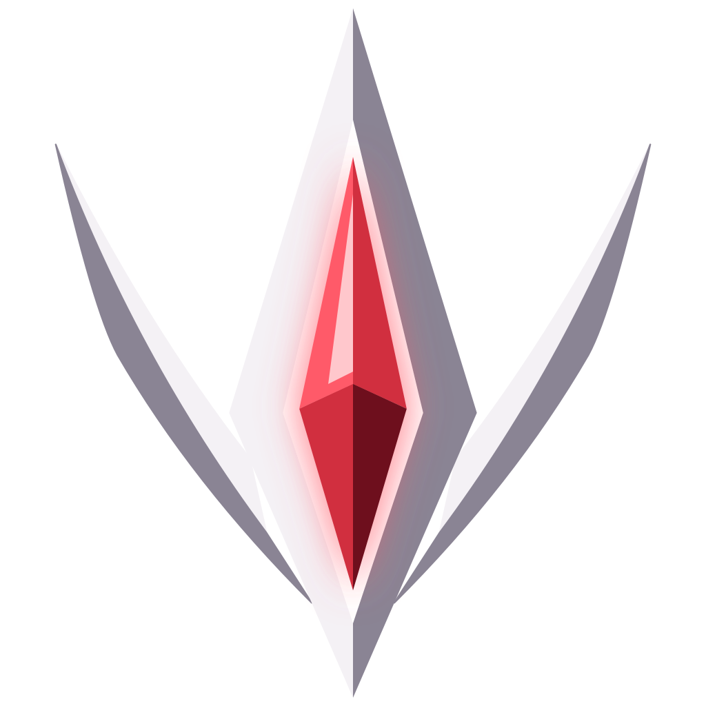
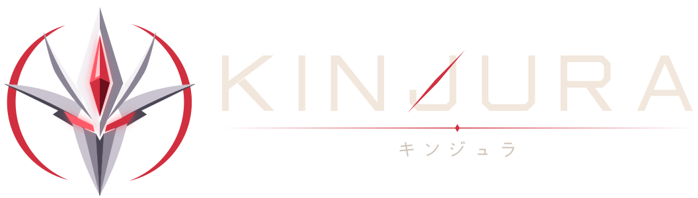
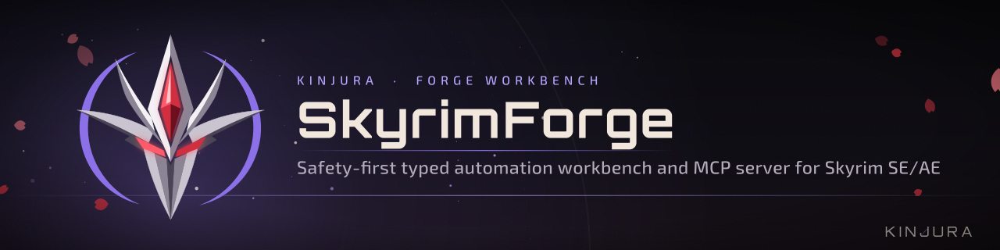
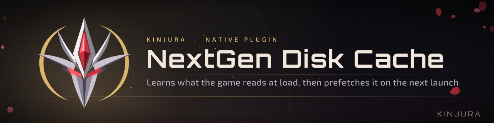

<p align="center">
  
</p>

# KINJURA brand kit

Every mark here is vector geometry drawn in code. Nothing is traced, upscaled or cut out of a generated image. The SVGs are the masters; the PNGs are rendered from them at exact sizes. Rebuild it all with one command and the output comes out byte-identical.

```
brand/
  kit/        the master kit (SVG + PNG)
  stamps/     per-project stamp sets (one folder per project)
  tools/      generators: build.mjs, stamp.mjs, intro.mjs
```

## The marks

| Crest (primary) | Emblem | Core (small sizes) |
| :-: | :-: | :-: |
|  |  |  |
| Crest, halo ring, crystal core | No ring; use it when the space is tight or busy | Spire + inner wings + crystal; for 64 px and below |



- **Crest** is the badge. The **wordmark** is drawn letterforms, not a font. Its crimson cut runs through the J.
- **Lockups:** `Stacked` (splash, covers), `Horizontal` (headers, loading screens), `Minimal` (watermarks, UI).
- **Colourways:** `Primary` (steel + crimson on dark), `Light` (ink + crimson on light backgrounds), `MonoIvory` / `MonoVoid` (one colour, for engraving, overlays and stamps), `Gold` (premium / releases), `Aether` (sci-fi / AI).

### Rules

- Clear space around any mark: at least the crystal's height on every side.
- Minimum size: the crest at 128 px, the core at 16 px, the wordmark 80 px wide (drop the katakana below 240 px).
- On a photo or busy art, use `MonoIvory` or put the mark on a void plate. Don't recolour the facets, add drop shadows or outlines, stretch it, or rotate it.
- The crystal core stays crimson in every lane. Only the ring and the atmosphere take the lane accent.
- Below 128 px, swap the crest for the core mark. The `_Small` icons already do this.

## Palette

| Token | Hex | Use |
| :-- | :-- | :-- |
| Void | `#0B0B10` | backgrounds, plates |
| Crimson | `#D12F3F` | the core, rules, the J cut, primary accent |
| Crimson Light | `#FF5A69` | glows, highlights |
| Ivory | `#F2E7DC` | wordmark, titles |
| Steel | `#C9C4CF` | metal facets, secondary text |
| Ash | `#9A94A3` | taglines, captions |
| Aurum | `#D9B46B` | native plugins, releases |
| Aether | `#8B70E8` | forge workbenches, agent tooling |
| Mist | `#6FA0C8` | Windows apps, utilities |

Machine-readable copies: `kit/00_Tokens/kinjura.tokens.json`, `kit/00_Tokens/kinjura.css`.

## Type

- **Wordmark:** custom geometry in `tools/type.mjs`. Never set "KINJURA" in a font.
- **Display:** Orbitron (project names). **Body:** Exo 2 (taglines, UI). **Japanese:** the drawn キンジュラ, or Noto Sans JP for running text. All three fonts are SIL OFL.
- Taglines are set in caps with wide tracking (0.42 em) and `·` separators.

## Stamping a project

Every project gets the same skeleton. Only the name, tagline and lane change.

| Lane | Accent | For |
| :-- | :-- | :-- |
| `games` | Crimson | mods, game content, the default |
| `forge` | Aether | Forge workbenches |
| `ai` | Aether | agent tooling, skills, MCP |
| `native` | Aurum | SKSE / C++ plugins |
| `release` | Aurum | release announcements |
| `app` | Mist | Windows apps, utilities |

```bash
cd brand/tools
npm install
node stamp.mjs --name "SkyrimForge" --tagline "Typed automation workbench for Skyrim SE/AE" --lane forge --out ../../../SkyrimForge/branding
```

Or put every project in `tools/projects.json` and run `node stamp.mjs --batch projects.json`.

A stamp set contains:

| File | Size | Where it goes |
| :-- | :-- | :-- |
| `header.svg` / `.png` | 1280×320 | top of the README |
| `badge.svg` | 28 px tall | under the header |
| `footer.svg` | 1280×72 | bottom of the README |
| `social.png` | 1280×640 | repo Settings → Social preview |
| `cover.png` | 1920×1080 | Nexus Mods primary image, store pages |
| `icon.svg`, `icon-1024/256/128.png` | | app icon, release art |
| `icon-64/32/16.png`, `favicon.ico` | | the core mark, for small sizes |
| `STAMP.md` | | the README snippet to paste |




**Old to new:** stamp the project, paste the `STAMP.md` header and footer into its README, upload `social.png`, and swap the app icon. A project counts as stamped once all four are done.

## Intro / startup sequence

`kit/07_Intro`: a 3.5 s startup sting rendered from the vector parts (per-part motion: ignition → halo → core → emblem locks → title reveal → hold).

- `KINJURA_Intro_1080p60.mp4` (H.264 + sting audio), `_Silent.mp4`, `KINJURA_Intro_60fps.webm` (VP9 + Opus), `KINJURA_Intro_Preview.gif`
- Six keyframes as SVG + PNG; the last frame matches the splash, so an app can hold or crossfade from it.

## Kit contents

| Folder | Contents |
| :-- | :-- |
| `00_Tokens` | colour + type tokens (JSON, CSS) |
| `01_Marks` | Crest / Emblem / Core × 6 colourways |
| `02_Wordmarks` | Latin wordmark and katakana × 6 colourways |
| `03_Lockups` | Stacked / Horizontal / Minimal × 6 colourways |
| `04_Icons` | app tiles in four lane colours (1024 → 16 px), circle avatar, `favicon.ico` |
| `05_Backgrounds` | unbranded 16:9 / 4K / ultrawide, splash, startup hold, loading, web + ultrawide banners, social card, transparent lower third |
| `06_FX` | ring, petal, petal scatter, spark, flare, divider (transparent) |
| `07_Intro` | animation + keyframes |

`kit/MANIFEST.txt` lists every file.

## Rebuilding

```bash
cd brand/tools
npm install
node build.mjs
node intro.mjs --audio path/to/sting.wav
```

Requirements: Node 20+. ImageMagick (`magick`) is needed only for `favicon.ico`, and `ffmpeg` only for the intro. To change a shape, edit `emblem.mjs` (crest), `type.mjs` (letters) or `layout.mjs` (compositions, lanes, colourways) and rebuild. Every asset updates from that one source.
